# 🧠 Awesome Knowledge Management Systems &amp; Team Wikis

**A curated directory of top SaaS knowledge platforms, AI-native documentation tools, and self-hosted open-source wikis.**

  
  
  
  
  
  

*Empowering engineering teams, support operations, knowledge managers, and organizations to conquer information silos, document standard operating procedures (SOPs), and build trustworthy institutional memory.*

---

## 📑 Table of Contents

- [🔍 Overview &amp; Key Trends](#-overview--key-trends)
- [📊 Sector Overview &amp; Market Dynamics](#-sector-overview--market-dynamics)
- [🏢 SaaS Knowledge Management Platforms](#-saas-knowledge-management-platforms)
- [🔓 Open-Source Knowledge Bases &amp; Wikis](#-open-source-knowledge-bases--wikis)
- [🏗️ Architectural Recommendations](#️-architectural-recommendations)
- [🤝 How to Contribute](#-how-to-contribute)
- [💖 Support &amp; Community](#-support--community)
- [📈 Star History](#-star-history)
- [⚖️ Disclaimer &amp; License](#️-disclaimer--license)

---

## 🔍 Overview &amp; Key Trends

Modern **Knowledge Management (KM)** is evolving rapidly beyond static document repositories. Today's software landscape bridges high-speed team wikis, developer documentation portals, and AI-augmented organizational memory:

- 🤖 **AI-Native Retrieval &amp; Agentic Assistants**: Contextual card discovery (Guru), automated freshness verification (Bloomfire, Slite), and RAG-driven enterprise search engines (ServiceNow Now Assist, Document360 Eddy AI).
- 🔗 **Bi-directional Linking &amp; Knowledge Graphs**: Interconnected node modeling popularized by tools like Logseq, Trilium, and Foam for associative thinking.
- 🛡️ **Data Sovereignty &amp; Local-First Architectures**: Self-hosted, end-to-end encrypted, and Git-backed wikis (Docmost, Outline, AppFlowy, BookStack) to retain complete ownership over intellectual property.

---

## 📊 Sector Overview &amp; Market Dynamics

The global **Knowledge Management software market** is estimated at **$5.8 billion to $7.2 billion in 2026** and projected to exceed **$18.5 billion by 2032**, demonstrating an impressive compound annual growth rate (CAGR) of ~14.2%, with the broader enterprise information management sphere encompassing over **$500+ billion**.

The sector exhibits **moderate fragmentation** rather than a single winner-take-all monopoly:
- **Enterprise ITSM &amp; Corporate Incumbents**: Market heavyweights such as ServiceNow and Atlassian Confluence dominate centralized IT governance, support ticketing workflows, and Fortune 500 compliance.
- **Productivity &amp; Modular Workspaces**: Fast-moving challengers like Notion, GitBook, and Slite command modern technology startups and developer teams through block-based editors and API extensibility.
- **Self-Hosted Open-Source Surge**: High per-seat enterprise licensing costs have driven a parallel surge in privacy-first, community-driven platforms (AppFlowy, Docmost, Outline, Wiki.js), giving engineering leaders viable alternatives to vendor lock-in.

---

## 🏢 SaaS Knowledge Management Platforms

Below is an exhaustive comparison of leading commercial Knowledge Management and team documentation platforms, ranked by **company scale (market valuation / annual revenue)** in descending order:

| 🏢 Platform | 📈 Company Scale (Valuation / Revenue) | 🎯 Core Focus &amp; Target Use Case | 💳 Starting Tier Pricing | 🎁 Free Tier / Free Trial Limits |
| :--- | :--- | :--- | :--- | :--- |
| **[ServiceNow KM](https://www.servicenow.com/)** | **~$185B Market Cap** (NYSE: NOW) • ~$10.9B ARR | Enterprise ITSM &amp; CSM knowledge workflows, automated incident-to-article authoring, and Now Assist generative AI. | **$100 / user / month** *(ITSM Pro annual contract)* | **15-day renewable Personal Developer Instance (PDI)** with full admin access to Knowledge Center, Now Assist AI, and ITSM modules. |
| **[Atlassian Confluence](https://www.atlassian.com/software/confluence)** | **~$48B Market Cap** (NASDAQ: TEAM) • ~$4.4B ARR | Enterprise team workspace with deep Jira integration, dynamic templates, whiteboards, and Rovo AI intelligence. | **$6.05 / user / month** *(Standard Tier)* | **Free forever plan for up to 10 users**, 2 GB total file storage, unlimited pages &amp; spaces, community support. |
| **[Notion](https://www.notion.com/)** | **~$10B Valuation** • ~$350M+ ARR *(Private)* | All-in-one workspace blending relational databases, nested wikis, project docs, kanban boards, and Notion AI. | **$10 / user / month** *(Plus tier; $8/mo billed annually)* | **Free forever plan for individual users** (unlimited blocks, 5 MB file upload limit, up to 10 guest collaborators); 1,000 blocks collaborative limit. |
| **[Guru](https://www.getguru.com/)** | **~$500M Valuation** • ~$30M+ ARR *(Private)* | Context-aware AI verification engine delivering bite-sized knowledge cards inside Slack, Chrome, and web apps. | **$15 / user / month** *(All-in-one AI plan)* | **30-day free trial for up to 30 users** with complete access to AI Answers, browser extension, and team integrations. |
| **[GitBook](https://www.gitbook.com/)** | **~$150M Valuation** • ~$15M+ ARR *(Private)* | Developer-centric technical documentation with native two-way GitHub/GitLab sync, Markdown, and AI search. | **$6.70 / user / month** *(Plus tier; billed annually)* | **Free forever plan for open-source &amp; individual projects** (1 site, 1 team member, unlimited public docs); 14-day free trial on Pro. |
| **[Document360](https://document360.com/)** | **~$50M Valuation** (Kovai.co) • ~$20M ARR | AI-first customer help centers, technical product portals, and internal SOPs powered by Eddy AI search and analytics. | **$149 / project / month** *(Standard tier, 3 team accounts)* | **14-day free trial with up to 5 team accounts**, 1 public or private knowledge base, and full Eddy AI search/chatbot features. |
| **[Bloomfire](https://bloomfire.com/)** | **~$40M Valuation** • ~$18M ARR *(Private)* | Enterprise knowledge intelligence indexing multi-format files (video, audio, PDF) with automated speech-to-text transcription. | **$25 / user / month** *(Starter plan, annual commitment)* | **30-day free trial for up to 25 team members** featuring AI deep search, automatic transcription, and compliance guardrails. |
| **[Slite](https://slite.com/)** | **~$25M Valuation** • ~$8M+ ARR *(Private)* | Minimalist AI team documentation platform featuring Ask AI enterprise search and automated doc freshness verification. | **$10 / user / month** *(Standard; $8/mo billed annually)* | **Free forever plan for up to 50 documents**, unlimited users, and standard AI search assistance. |
| **[Helpjuice](https://www.helpjuice.com/)** | **~$20M Valuation** • ~$7M ARR *(Private)* | Specialized customer self-service support portal with custom visual styling, decision trees, and intelligent search. | **$120 / month** *(Starter tier; up to 4 users included)* | **14-day free trial with unlimited users**, unlimited articles, full analytics, and complimentary custom knowledge base design. |
| **[Slab](https://slab.com/)** | **~$15M Valuation** • ~$5M ARR *(Private)* | Clean, fast team wiki with unified search across Google Drive, GitHub, Slack, Asana, and Jira. | **$8 / user / month** *(Startup; $6.67/mo billed annually)* | **Free forever plan for up to 10 users** with 90-day version history and 10 MB per attachment limit. |

---

## 🔓 Open-Source Knowledge Bases &amp; Wikis

Self-hosted and open-source documentation platforms enable complete data sovereignty, eliminate per-seat licensing fees, and prevent vendor lock-in. 

The list below is sorted strictly by **GitHub star count** in descending order:

1. ### 🌟 [AppFlowy](https://github.com/AppFlowy-IO/AppFlowy) 
   - **License**: AGPL-3.0 | **Tech Stack**: Flutter, Rust
   - **Highlights**: The leading open-source Notion alternative. An AI-powered collaborative workspace bringing wikis, notes, project tracking, and database boards together with 100% offline-first and self-hosted privacy.
   - **Best For**: Teams and individuals wanting Notion capabilities with native desktop speed and zero cloud data sharing.

2. ### 🎨 [AFFiNE](https://github.com/toeverything/AFFiNE) 
   - **License**: MIT | **Tech Stack**: TypeScript, Rust, React
   - **Highlights**: Next-gen workspace combining structured document writing, Miro-style infinite canvas whiteboarding, and multidimensional database grids into a single unified knowledge canvas.
   - **Best For**: Creative teams, visual system architects, and cross-functional product squads.

3. ### 📝 [Memos](https://github.com/usememos/memos) 
   - **License**: MIT | **Tech Stack**: Go, React, SQLite
   - **Highlights**: Lightweight, privacy-first self-hosted micro-knowledge management and social note-taking stream. Features Markdown support, tag trees, RESTful APIs, and zero-overhead single-container Docker setup.
   - **Best For**: Quick daily thought capture, engineering activity logs, and personal micro-wikis.

4. ### 🔒 [Joplin](https://github.com/laurent22/joplin) 
   - **License**: AGPL-3.0 | **Tech Stack**: TypeScript, Electron, React Native
   - **Highlights**: Battle-tested note-taking and knowledge manager featuring client-side End-to-End Encryption (E2EE), Markdown rendering with math/diagram plugins, web clipper, and multi-cloud sync (Nextcloud, Dropbox, WebDAV).
   - **Best For**: Security-conscious professionals needing synchronized cross-platform notes without third-party snooping.

5. ### 🌲 [Logseq](https://github.com/logseq/logseq) 
   - **License**: AGPL-3.0 | **Tech Stack**: ClojureScript, Electron
   - **Highlights**: Privacy-first, local-first outliner and personal knowledge graph based on plain-text Markdown and Org-mode files. Offers bidirectional link references, Flashcards (spaced repetition), and interactive graph visualization.
   - **Best For**: Researchers, academics, and developers building personal knowledge networks (PKM).

6. ### 🚀 [Outline](https://github.com/outline/outline) 
   - **License**: BSL 1.1 / Source Available | **Tech Stack**: Node.js, React, PostgreSQL, Redis
   - **Highlights**: Beautiful, lightning-fast internal team wiki designed for growing engineering organizations. Features a Notion-grade block editor, real-time multi-user editing, OIDC/SAML corporate single sign-on, and deep REST APIs.
   - **Best For**: Modern tech companies with corporate SSO wanting a high-polish internal wiki.

7. ### 🌳 [Trilium Notes](https://github.com/zadam/trilium) 
   - **License**: AGPL-3.0 | **Tech Stack**: JavaScript, Node.js, SQLite
   - **Highlights**: Hierarchical knowledge management system tailored for large note trees. Supports arbitrarily deep nesting, relationship maps, integrated note scripting, revision history, and encrypted sub-trees.
   - **Best For**: Power users and systems thinkers managing tens of thousands of complex technical notes.

8. ### 🌐 [Wiki.js](https://github.com/requarks/wiki) 
   - **License**: AGPL-3.0 | **Tech Stack**: Node.js, Vue.js, PostgreSQL/MySQL/SQLite
   - **Highlights**: High-performance, modular wiki software with two-way Git synchronization, flexible authentication engines (Google, GitHub, LDAP, SAML), and support for Markdown, AsciiDoc, and visual WYSIWYG editors.
   - **Best For**: Developer hubs, public knowledge repositories, and multi-language technical documentation.

9. ### 📄 [Docmost](https://github.com/docmost/docmost) 
   - **License**: AGPL-3.0 | **Tech Stack**: TypeScript, NestJS, React, PostgreSQL
   - **Highlights**: Fast-growing collaborative open-source Confluence and Notion alternative. Includes nested spaces, real-time multi-cursor collaboration, granular permission controls, and native diagrams (Draw.io, Excalidraw, Mermaid).
   - **Best For**: Engineering teams wanting a self-hosted collaborative documentation platform with built-in email auth and turnkey Docker setup.

10. ### 📚 [BookStack](https://github.com/BookStackApp/BookStack) 
    - **License**: MIT | **Tech Stack**: PHP, Laravel, MySQL
    - **Highlights**: Intuitive documentation system built around the physical book metaphor: Shelves &gt; Books &gt; Chapters &gt; Pages. Highly accessible to non-technical users, with granular RBAC, Markdown/WYSIWYG switching, and multi-language support.
    - **Best For**: Internal company handbooks, operational manuals, and non-technical staff onboarding.

11. ### 🫧 [Foam](https://github.com/foambubble/foam) 
    - **License**: MIT | **Tech Stack**: TypeScript, VS Code
    - **Highlights**: Extensible personal knowledge management and sharing framework built right inside Visual Studio Code. Inspired by Roam Research and Obsidian, utilizing plain Markdown files, wikilinks, and Git version control.
    - **Best For**: Programmers who want their second brain to live entirely inside their favorite code editor.

12. ### 🐙 [Gollum](https://github.com/gollum/gollum) 
    - **License**: MIT | **Tech Stack**: Ruby, Git
    - **Highlights**: Simple, Git-powered wiki engine backing GitHub Wikis. Allows editing via web interface or locally via raw text files in a standard Git repository, supporting MediaWiki, Markdown, and Org syntax.
    - **Best For**: Git-native teams wanting zero proprietary database requirements.

13. ### 🌲 [Dendron](https://github.com/dendronhq/dendron) 
    - **License**: AGPL-3.0 | **Tech Stack**: TypeScript, VS Code
    - **Highlights**: Hierarchical, schema-driven knowledge management system. Keeps notes structured as you scale with schema validation, flexible lookup, refactoring commands, and static site export.
    - **Best For**: Large-scale developer knowledge bases and structured technical personal wikis.

14. ### ⚡ [SilverBullet](https://github.com/silverbulletmd/silverbullet) 
    - **License**: MIT | **Tech Stack**: TypeScript, Deno
    - **Highlights**: An extensible, programmable personal knowledge base. Your documents exist as plain Markdown files enhanced with live SQL-like queries, custom Space Script (Lua), and offline Progressive Web App (PWA) functionality.
    - **Best For**: Hacker-friendly note taking and dynamic knowledge scripting.

15. ### 📖 [DokuWiki](https://github.com/dokuwiki/dokuwiki) 
    - **License**: GPL-2.0 | **Tech Stack**: PHP
    - **Highlights**: Legendary, standards-compliant open-source wiki engine operating completely without a database (pure plain-text flat files). Boasts an ecosystem of thousands of plugins and themes.
    - **Best For**: Low-maintenance corporate intranets, embedded devices, and lightweight shared documentation.

16. ### 🏛️ [XWiki](https://github.com/xwiki/xwiki-platform) 
    - **License**: LGPL-2.1 | **Tech Stack**: Java
    - **Highlights**: Enterprise-grade open-source collaborative wiki application engine. Features structured data forms, programmable scripting (Velocity, Groovy), granular ACLs, and official Confluence migration importers.
    - **Best For**: Complex enterprise intranet deployments and large organizations migrating away from Atlassian Confluence.

---

## 🏗️ Architectural Recommendations

| Deployment Profile | Recommended Stack | Key Architectural Justification |
| :--- | :--- | :--- |
| **Enterprise IT &amp; Service Desk** | **[ServiceNow KM](https://www.servicenow.com/)** or **[Confluence](https://www.atlassian.com/software/confluence)** | Direct binding to Jira / ServiceNow ticket resolution, ITIL process compliance, and audit trails. |
| **High-Growth Tech Startups** | **[Notion](https://www.notion.com/)** or **[Slite](https://slite.com/)** | Rapid onboarding, multi-purpose database views, and automated doc hygiene workflows. |
| **Self-Hosted Team Wiki (Confluence Alt)** | **[Docmost](https://github.com/docmost/docmost)** or **[Outline](https://github.com/outline/outline)** | Real-time multi-cursor editing, diagram rendering, and complete control over data privacy. |
| **Customer-Facing Knowledge Base** | **[Document360](https://document360.com/)** or **[Helpjuice](https://www.helpjuice.com/)** | Brandable customer portals, deep search analytics, SEO optimization, and article deflection metrics. |
| **Developer Documentation &amp; Git Sync** | **[GitBook](https://www.gitbook.com/)** or **[Wiki.js](https://github.com/requarks/wiki)** | Bidirectional Git integration, markdown-as-code, and versioned API documentation workflows. |
| **Personal Knowledge Graph (PKM)** | **[AppFlowy](https://github.com/AppFlowy-IO/AppFlowy)**, **[Logseq](https://github.com/logseq/logseq)**, or **[Joplin](https://github.com/laurent22/joplin)** | Local-first file storage, bidirectional linking, zero telemetry, and mobile synchronization. |

---

## 🤝 How to Contribute

Contributions are warmly welcomed! Help keep this repository the premier directory for knowledge management tools:

1. 🍴 **Fork the repository** on GitHub.
2. 🌿 **Create a new branch** (`git checkout -b feature/add-new-km-tool`).
3. ✏️ **Add your entry** following existing format:
   - For SaaS: include product name, pricing, free tier/trial details, and company scale.
   - For Open-Source: include project link, stargazers star badge (`style=social&color=white`), license, and core highlights.
4. 📬 **Submit a Pull Request** with a concise explanation of why the tool is valuable.

---

## 💖 Support &amp; Community

Thank you so much for exploring and supporting **Awesome Knowledge Management**! Building open, comprehensive, and up-to-date resources for the community requires ongoing dedication and research.

If you find this repository helpful:
- ⭐ **Star this repository** to boost discoverability for fellow builders and managers.
- 🍴 **Fork &amp; share** it with your engineering team, operations peers, and community.
- ☕ **Support the maintainer**: Buy a coffee and support continuous updates through the [GitHub Sponsor Dashboard](https://github.com/sponsors/ishandutta2007).

---

## 📈 Star History

---

## ⚖️ Disclaimer &amp; License

- This repository is a community-curated directory compiled for educational, research, and benchmarking purposes. All product names, logos, and brands belong to their respective copyright holders.
- Pricing, free tiers, and feature sets change over time; please verify latest terms on vendor official portals.
- Distributed under the [MIT License](LICENSE).

---

**[Awesome Knowledge Management](https://github.com/ishandutta2007/Awesome-Knowledge-Management)** • Curated with ❤️ by [Ishan Dutta](https://github.com/ishandutta2007)

